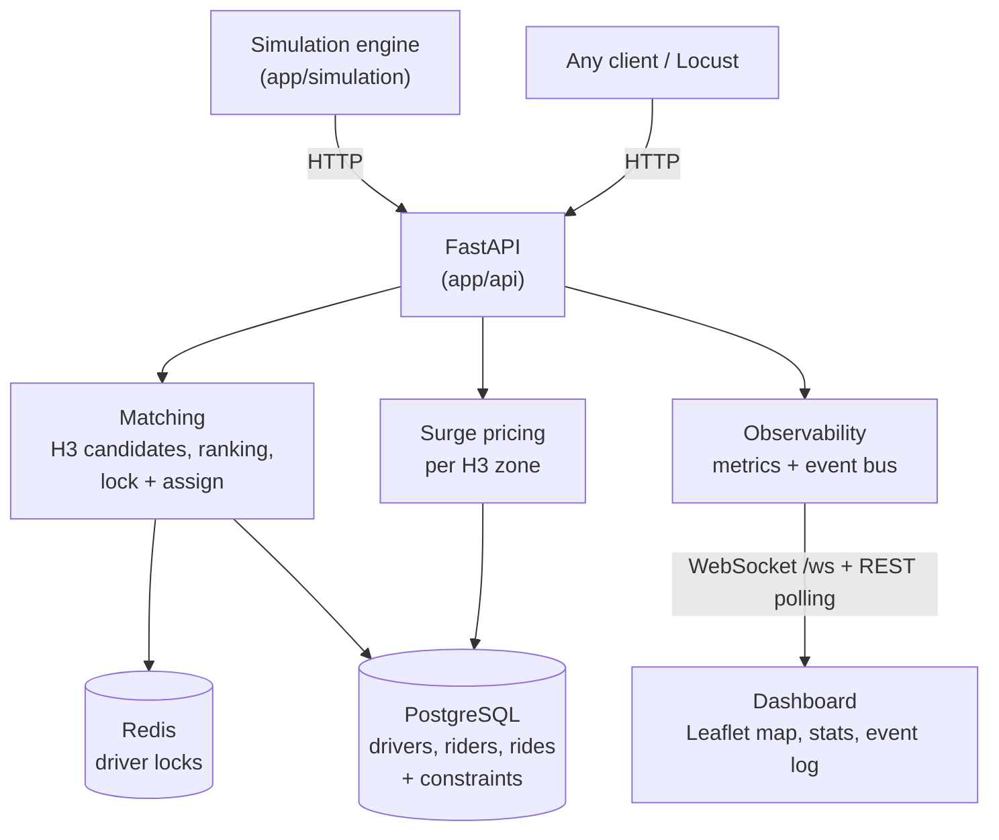

# Real-Time Ride-Matching Engine

A backend that matches ride requests to nearby available drivers **under concurrent access**, with per-zone surge pricing and a
live dashboard. Python 3.12, FastAPI, H3, Redis, PostgreSQL.

The domain is ride-hailing, but the pattern is general: **matching a scarce resource to a requester while many requesters compete for it, and
keeping the result correct** (dispatch, inventory, ticket booking, payments). A portfolio project, not a production system; see [what is and isn't guaranteed](#what-is-and-isnt-guaranteed).

**What it demonstrates**

| Skill | Where |
|---|---|
| Geospatial candidate discovery | H3 cell rings narrow candidates; real haversine distance ranks them |
| Concurrency correctness | Redis lock reduces contention; a Postgres partial unique index enforces one active ride per driver |
| Idempotency | `Idempotency-Key` on `POST /rides`, backed by a unique constraint |
| Surge pricing | Multiplier from live demand/supply per H3 zone |
| Observability | p50/p95/p99 match latency, throughput, lock contention, DB latency via `GET /stats` |
| Failure behavior | Reproducible failure tests and a measured saturation point |

## Demo

🎥 [Watch the live ride-matching dashboard demo](https://youtu.be/HoKFBz3226k)

## Quickstart

Requires Docker + Docker Compose (plus a Python 3.12 venv for the simulator and tests: `python3.12 -m venv venv && ./venv/bin/pip install -e ".[dev]"`).

```bash
docker compose up                                          # postgres + redis + app; migrations run automatically
./venv/bin/python -m app.simulation --duration-seconds 30  # second terminal: synthetic traffic
```

Then open <http://localhost:8000/health>, <http://localhost:8000/docs> and the dashboard <http://localhost:8000/dashboard/>. Compose is the
development configuration (`uvicorn --reload`); the tuned demo command is in [scripts/demo.md](scripts/demo.md).

## Architecture



It is a **modular monolith**: one FastAPI process, no message broker, no extra services.

| | Responsibility |
|---|---|
| **PostgreSQL** | Durable source of truth: drivers, riders, rides, and the constraints that protect invariants |
| **Redis** | Short-lived per-driver locks (`lock:driver:{id}`) that coordinate concurrent workers; no durable state |

### How a ride request is matched

1. **H3 narrows candidates:** expand H3 rings around the pickup cell and query available drivers in those cells.
2. **Real distance ranks them:** haversine distance, nearest first. H3 finds candidates; it does not rank them.
3. **Lock:** for each candidate, `SET key token NX PX ttl` with a unique token; if it is taken, try the next candidate.
4. **Re-check under the lock:** re-read the driver from the database (not a cached copy); skip it if no longer `available`.
5. **Assign, commit, then release:** mark the driver `busy` and the ride `matched`, **commit**, then release the lock only if the token
   still matches. The partial unique index on active rides per driver rejects any second active ride, whatever the lock did.

If no driver can be assigned, the ride stays `requested` and the API still returns `201`: "no driver right now" is a normal outcome.

## Design decisions

**H3 for candidate discovery.** Hexagonal cells have uniform neighbor distances, and "nearby" becomes an indexed `h3_index IN (...)` query.
PostGIS (heavier than needed) and Redis GEO (blurs Redis's coordination role) were rejected; cell membership is not distance, so ranking uses real distance.

**Redis lock for coordination.** Atomic `SET NX PX` with a unique token; a Lua compare-and-delete releases it, so a worker whose lock
expired cannot delete someone else's. The TTL (5s default) is a tradeoff: too short and a slow holder loses the lock, too long and a
crashed worker's driver waits. It is hand-written, single-instance, with no fencing token, so it is not trusted alone.

**PostgreSQL as the correctness boundary.** A partial unique index (`UNIQUE(driver_id)` over `requested`, `matched` and `in_progress`
rides) makes a second active ride for one driver impossible to commit, whether or not the lock worked. The lock makes hitting it rare
and cheap; correctness rests on the index at the default `READ COMMITTED` isolation. `match_ride` commits before releasing the lock.

**Atomic ride transitions.** Cancel, complete and the matcher's `requested → matched` each use one conditional `UPDATE ... WHERE status IN (...)`
and check the row count, so no Redis lock is needed. This closed a real bug where a concurrent cancel could be overwritten back to `matched`.

**Idempotency.** Clients retry when a response is lost, so `POST /rides` accepts `Idempotency-Key`; a unique constraint means concurrent duplicates
cannot both insert and the loser returns the winner's ride. Reusing a key with a different rider or pickup returns `409`.

**Surge pricing.** `multiplier = clamp(1.0 + 0.5 × demand / max(supply, 1), 1.0, 3.0)` per H3 zone (resolution 6), quoted at request time;
approximate, since demand and supply are two unlocked reads.

## What is and isn't guaranteed

**1. Enforced by PostgreSQL** (independent of Redis and application code); "guarantee" is used only in this narrow sense
- At most one active ride per driver in committed state (partial unique index `ux_rides_one_active_ride_per_driver`); a violating
  writer gets an `IntegrityError` and is treated as having lost the race.
- At most one ride per idempotency key (unique constraint `uq_rides_idempotency_key`).

**2. Demonstrated by automated tests** (the scenarios as written, not a formal proof)
- 5, 20 and 50 concurrent requests for one driver: exactly one wins and none ends with two active rides (the constraint is also tested with
  the lock bypassed); requests sharing an `Idempotency-Key` all get the same ride; a cancel racing a match never leaves a cancelled ride `matched`.
- Simulated worker crashes (patched, not a real kill) leave no duplicate assignment; database or Redis failures return a structured `503`.

**3. Measured once, on one machine:** see [Benchmarks](#benchmarks). Observations, not properties of the design.

**4. Limitations and non-guarantees**
- **Not fault tolerant, not exactly-once.** After a worker crash the driver is matchable again once the lock TTL (5s default) expires, but a
  ride left in `requested` is **not automatically retried**; a client retry re-attempts matching.
- **The lock is not the correctness boundary.** A stalled holder can lose it; the Postgres constraint then rejects the conflicting
  write, so the outcome is a lost race, not a double assignment.
- **A Redis outage stops matching** (`503`); there are no retries, circuit breaker, or failover.
- **No admission control.** Overload queues behind a 15-connection DB pool for up to 30s, then fails with `503`: a bounded queue, not a deadlock.
- **Metrics are in-memory and single-process** (reset on restart; the WebSocket event bus assumes one uvicorn process). **Surge is
  approximate.** There is no authentication and no `fare` calculation.
- **Known issue, not fixed:** a `422` validation response's `message` is built from the raw exception text, which includes an internal
  file path and line number. The envelope shape (`error.code`, `error.message`) is unaffected.

## Failure scenarios

Each is an executable test in [`tests/failure/`](tests/failure/); no ride is lost and no duplicate assignment occurs ([full write-up](docs/chaos-testing.md)).

| Scenario | DB committed? | Recovery and retry |
|---|---|---|
| Worker dies **holding the lock, before commit** | No | Lock expires after the TTL and the driver can be matched again; the crashed ride stays `requested` until the client retries |
| Worker dies **after commit, before release** | Yes | Nothing needed: state is correct and the orphaned lock is inert until it expires |
| **Database error** during commit | No | Structured `503 database_error`, lock released normally; client retries (same `Idempotency-Key` is safe) |
| **Redis unreachable** at lock acquisition | Nothing written | Structured `503 locking_unavailable`, fails fast; client retries once Redis is back |

## Benchmarks

Locust, 60s per tier (each user repeatedly creates a rider, then requests a ride), against a plain `uvicorn` process (no `--reload`, single
worker) with Postgres 16 and Redis 7 on one machine: MacBook Air, Apple M1, 8 cores / 8 GB RAM, macOS 26.2, Docker 29.7.2, Python 3.12.8,
Locust 2.46.6. Each tier starts from a freshly reset, deliberately undersized 50-driver pool. Single run per tier, shared hardware.

| Tier | Users | Total requests | Failures | Median | p95 | p99 | Throughput (req/s) |
|---|---|---|---|---|---|---|---|
| Baseline | 15 | 13,977 | 0 (0.0%) | 30ms | 89ms | 140ms | 236.3 |
| Tier 2 | 100 | 772 | 21 (2.7%) | 120ms | 30,000ms | 30,000ms | 23.0 |
| Tier 3 | 500 | 307 | 25 (8.1%) | 180ms | 30,000ms | 30,000ms | 9.7 |
| Tier 4 | 1000 | 76 | 37 (48.7%) | 30,000ms | 30,000ms | 30,000ms | 2.5 |

- **Saturation comes from the bounded DB connection pool:** 15 connections (`pool_size=5 + max_overflow=10`) behind 40 worker threads, as
  predicted before running. From 100 users up, p95/p99 sit at 30,000ms (SQLAlchemy's default `pool_timeout`); 1000 users shows saturation, not capacity.
- **Matching itself was not the bottleneck:** server-side `match_ride` p99 was 61.2–134.5ms in the tiers where it was captured.
- **The 1000-user stall was connection-pool queuing, not a deadlock:** the server stopped answering (including `/health`); a thread dump
  showed all 40 worker threads waiting in the pool queue. A 300-user reproduction recovered after 3 min 28 s; the 1000-user run was not
  re-verified, so no recovery time is claimed for it.

Full methodology and investigation: [docs/benchmarks.md](docs/benchmarks.md). Raw CSV/JSON: [`load_tests/results/`](load_tests/results/).

## API

Interactive reference at `/docs`. Errors always use one envelope: `{"error": {"code": "...", "message": "..."}}`.

| Method and path | Purpose |
|---|---|
| `POST /drivers`, `GET /drivers`, `GET /drivers/{id}`, `PATCH /drivers/{id}/location`, `POST /riders` | Create, list (`?status=`), read, move drivers; create riders |
| `POST /rides` (`Idempotency-Key` supported), `GET /rides/{id}`, `POST /rides/{id}/cancel`, `POST /rides/{id}/complete` | Request and match a ride; read and transition it |
| `GET /stats`, `GET /zones/{zone_id}/surge` | Live counts and latency percentiles; a zone's demand, supply and multiplier |
| `GET /health`, `WebSocket /ws` | Liveness (checks Postgres and Redis); live event stream (best-effort, for display) |

```bash
# Retrying with the same key returns the same ride; the same key with a different pickup is a 409
curl -s -X POST localhost:8000/rides -H 'Content-Type: application/json' -H 'Idempotency-Key: demo-key-1' \
  -d '{"rider_id": "<rider id>", "pickup_lat": 37.7749, "pickup_lng": -122.4194}'
# 201 {"id": "d66399c3-...", "driver_id": "bcf0912d-...", "status": "matched", "surge_multiplier": 1.0, ...}
```

## Testing

```bash
docker compose up -d postgres redis      # tests need Postgres + Redis
./venv/bin/pytest tests/ -v
```

Suites: `tests/unit`, `tests/integration`, `tests/concurrency` (real threads, real commits) and `tests/failure`. CI
([.github/workflows/ci.yml](.github/workflows/ci.yml)) runs them against Postgres 16 and Redis 7 after `alembic upgrade head`. Last full run (full stack up):
`209 passed, 0 failed, 0 skipped`. One test (`test_simulation_contention.py`) needs the full stack up and is not run in CI.

## Project layout

```text
app/
  api/            FastAPI routers (drivers, riders, rides, zones, stats, websocket)
  matching/       H3 geometry, candidate search, ranking, match_ride (lock + assign)
  redis/          Redis client and the hand-written distributed lock
  services/       ride creation, idempotency, cancel/complete
  pricing/        surge zones and multiplier
  models/ storage/ schemas/   SQLAlchemy models, repositories, Pydantic schemas
  observability/  metrics, DB latency, event bus
  simulation/     standalone traffic generator
dashboard/        Leaflet map + stats + live event log (HTML/CSS/JS)
migrations/       Alembic migrations
tests/            unit, integration, concurrency, failure
load_tests/       Locust scenario, benchmark runner, recorded results
docs/             detailed chaos-testing and benchmark write-ups
```

## Build plan

- [x] Slice 1 — Core schema + models
- [x] Slice 2 — Geospatial matching
- [x] Slice 3 — Concurrency safety
- [x] Slice 4 — Idempotency
- [x] Slice 5 — Surge pricing
- [x] Slice 6 — FastAPI layer
- [x] Slice 7 — Simulation engine
- [x] Slice 8 — Dashboard
- [x] Slice 9 — Load testing + chaos testing
- [x] Slice 10 — Documentation and polish
